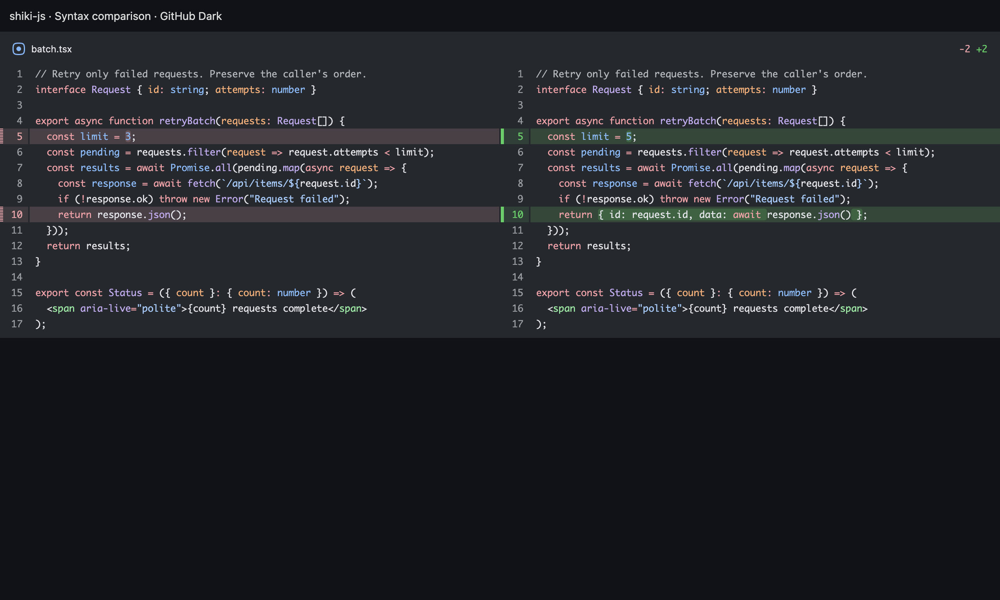
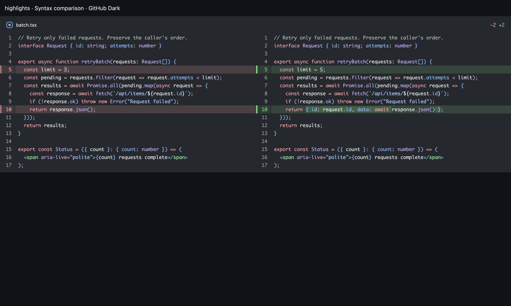

# Pierre Highlights trial

Highlights substantially reduces synchronous diff rendering time on the tested TypeScript files. Keep this as an opt-in trial: its language coverage is narrower than Shiki, and its syntax colors are similar but not identical.

## Try it

Open **Settings → Appearance → Syntax highlighting**. Choose **Highlights — faster rendering** or **Shiki — broader language support**. The choice saves automatically. Quit and reopen Gnosis to apply it; changing the setting leaves current reviews and background work running.

Shiki is the default for existing installs. A saved choice takes precedence over the developer trial flag:

```sh
VITE_GNOSIS_HIGHLIGHTER=highlights npm start
```

Without a saved choice or this variable, Gnosis keeps `shiki-js`. The selection is fixed for the renderer lifetime. It applies to Changes, Commits, explanation diffs, unchanged moved files, and downloaded LFS text. Markdown code blocks and saved Shiki HTML remain on their existing paths.

## Measurements

Measured on 2026-10-30, Apple M5 Max, macOS arm64, Electron 41.2.1, Chromium 146.0.7680.188. Base: `aa9ebf9` (0.31.0). Packages: `@pierre/diffs@1.6.1`, `@pierre/highlights@0.2.0`, `shiki@4.5.0`.

Medians of 15 measured iterations per engine and sample, across three fresh Electron windows per engine. One warm-up iteration per stage and sample is excluded. Engine order is Shiki, Highlights, Highlights, Shiki, Shiki, Highlights.

**Synchronous diff preparation and render** includes parsing, tokenization, and DOM construction. It excludes browser layout/paint and does not measure full application navigation.

| Input | UTF-8 size | Shiki | Highlights | Speedup |
| --- | ---: | ---: | ---: | ---: |
| PrFileInspection.tsx | 34.2 KB | 234.4 ms | 9.4 ms | 24.9× |
| PrFileInspection-added.tsx | 34.2 KB | 125.2 ms | 19.9 ms | 6.3× |
| main-excerpt.ts | 81.3 KB | 596.9 ms | 14.2 ms | 42.0× |
| globals-excerpt.css | 81.4 KB | 150.5 ms | 13.1 ms | 11.5× |
| package-lock-excerpt.json | 79.9 KB | 30.2 ms | 9.1 ms | 3.3× |
| main-large.ts | 119.7 KB | 924.4 ms | 18.8 ms | 49.2× |
| globals-large.css | 212.9 KB | 417.6 ms | 28.2 ms | 14.8× |
| package-lock-large.json | 794.2 KB | 280.8 ms | 80.9 ms | 3.5× |

**Through two animation frames** includes browser scheduling and layout after the synchronous render. This is a responsiveness proxy, not a GPU presentation timestamp.

| Input | Shiki | Highlights |
| --- | ---: | ---: |
| PrFileInspection.tsx | 243.0 ms | 16.9 ms |
| PrFileInspection-added.tsx | 202.7 ms | 87.8 ms |
| main-excerpt.ts | 604.2 ms | 20.7 ms |
| globals-excerpt.css | 156.0 ms | 18.7 ms |
| package-lock-excerpt.json | 35.5 ms | 15.6 ms |
| main-large.ts | 933.0 ms | 28.1 ms |
| globals-large.css | 433.7 ms | 39.3 ms |
| package-lock-large.json | 286.9 ms | 89.5 ms |

Raw tokenization is faster still, but is only one part of opening a diff. For the 120 KB TypeScript sample it falls from 469.6 ms to 2.2 ms. The full added-file case shows the remaining cost: drawing 796 lines still takes about 88 ms through two frames. The 794 KB JSON sample also remains above a frame budget.

## Method and limits

- Inputs are repository source files. The excerpt samples end at the last newline before 80,000 JavaScript characters; the JSON excerpt is not a complete JSON document. Raw results record hashes, character counts, and line counts.
- Most samples contain three trailing-space edits at 20%, 50%, and 80% of the file. Each renders 42 lines in split view with three context lines. The added-file sample renders all 796 lines.
- Both engines use the same Pierre `FileDiff` path, Gnosis GitHub Dark palette, viewport, and diff options. The highlighter is preloaded, but each render creates a new diff and renderer without content cache keys. Full-file contents are supplied; this is not a patch-only benchmark.
- Each iteration verifies preserved token text and multiple syntax colors in both tokens and the rendered DOM. Unsupported-language plaintext is tested separately.
- Tokenization limits are unchanged. Pierre 1.6.1 checks complete-file diff line arrays against its 100,000 threshold; it is not a 100 KB cutoff. These samples are below that limit.
- `setupMs` excludes module loading and WASM initialization and is not a cold-start comparison. `maxBlockMs` spans tokenization, validation, render, warm-up, and cleanup; it is not an isolated render measure.
- This does not measure GitHub requests, disk access, full React navigation, memory, packaged startup, all languages, or other hardware. The existing large-PR limits still apply. Absolute timings vary with machine load.

## Readability and compatibility

All ten Gnosis palettes retain the existing 4.8:1 contrast floor against context and changed-line surfaces. The adapter retains font styles and weights. Unicode and mixed-syntax checks cover TSX, Rust, Python, C++, HTML, and SQL.

The screenshot comparison keeps comments, keywords, strings, and changes readable. Highlights colors some punctuation, properties, and variables differently. These samples do not establish complete grammar parity.

| Shiki | Highlights |
| --- | --- |
|  |  |

Highlights recognizes 137 of the 346 language IDs exported by the installed Shiki bundle. Unsupported IDs include `cobol`, `dotenv`, `ini`, `prisma`, and `nginx`; Pierre renders them as plain text. Common languages such as TypeScript, TSX, Rust, Python, C++, C#, Go, Swift, SQL, YAML, and Markdown are supported.

Pierre allows only one highlighter backend per thread. A safe per-language Shiki fallback needs separate worker isolation or another rendering path. The trial does not silently change the shared backend per file.

## Verification

- 33 targeted unit tests: contrast, Highlights source preservation/fallback, review diffs, and saved-choice precedence.
- TypeScript and ESLint for changed code.
- Production renderer build with Highlights enabled.
- Settings browser checks: persistence, startup selection in both directions, deferred switching, save failure/retry, and light/dark narrow layout.
- Seven browser suites with Highlights enabled: Changes, Commits, Explanation, moved files, LFS, context controls, and split diff/comments/selection.

## Reproduce

```sh
npm ci
npm run benchmark:highlights
```

Results default to `/tmp/gnosis-highlights-results.json`; comparison screenshots use the same filename stem. Set `GNOSIS_BENCHMARK_OUTPUT` to choose another JSON path. Run without other intensive tasks.

[Recorded raw measurements](pierre-highlights/results.json).

Reference: [Pierre Highlights](https://diffs.com/highlights).
