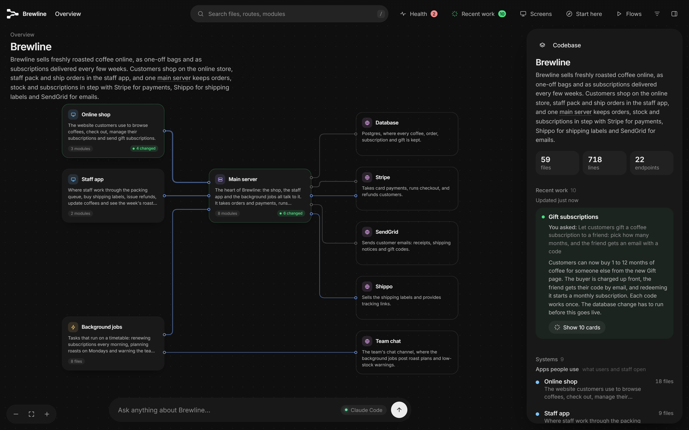
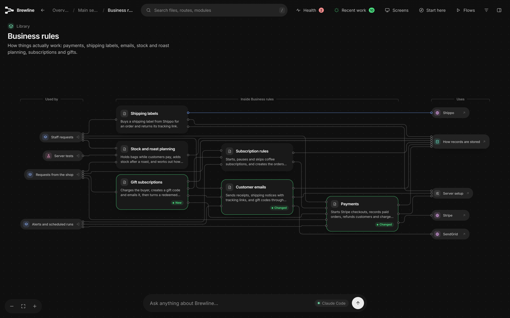
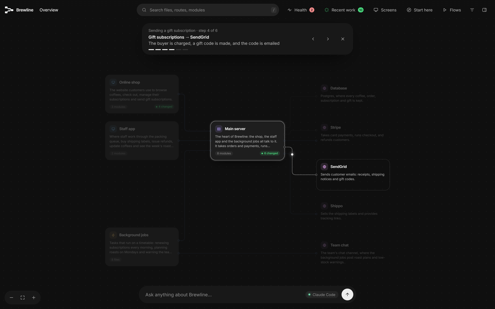
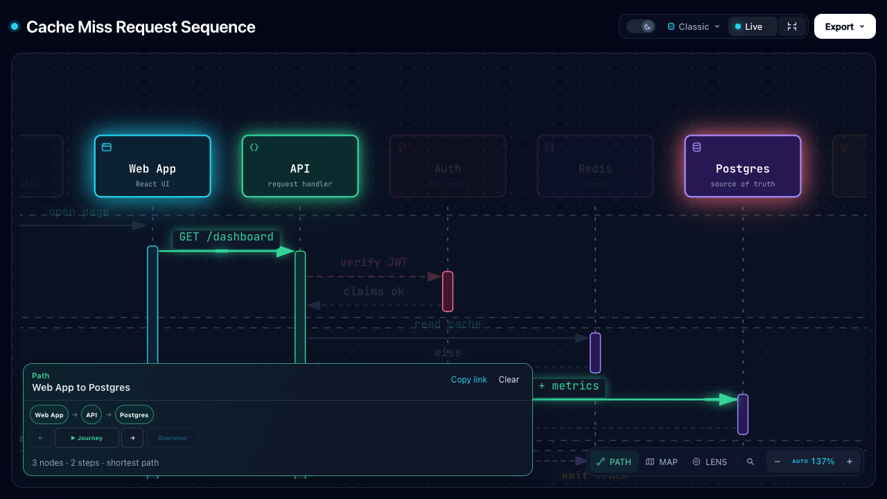
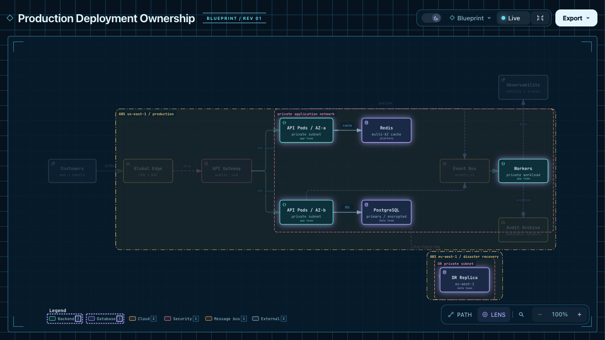
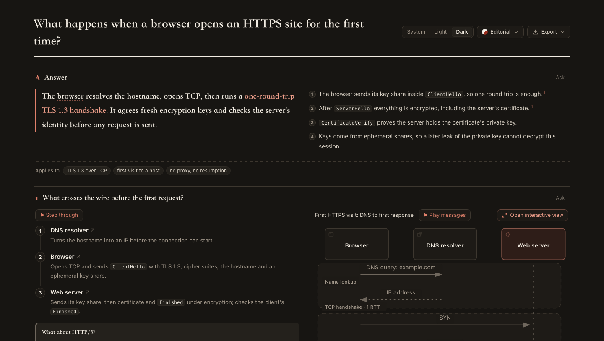

# Diagram reference pack

Selected diagrams and authoring instructions from Floorplan and Archify, collected for Gnosis explanation design. This is a research collection, not an installed skill, runtime dependency, or change to production prompts.

All upstream files are copied byte-for-byte. Local filenames sometimes differ. [The manifest](manifest.json) records the original path, pinned commit URL, and SHA-256 for every copied file. Follow its upstream links for references that do not resolve within this selected collection.

- Floorplan: `haydenschmitty/floorplan@70be3f40f9c2e061290b76027f180d9ff892edd6`, [MIT license](floorplan/LICENSE).
- Archify: `tt-a1i/archify@a4065941f12be7967436261d9934784e381d423c`, [Apache-2.0 license](archify/LICENSE), [notice](archify/NOTICE), [historical MIT notice](archify/LICENSE-MIT), and [third-party notices](archify/THIRD_PARTY_NOTICES.md).

Screenshots are upstream examples, not Gnosis output or results from our own execution. Logos and names do not imply endorsement. No upstream executables, viewer bundles, fonts, or agent integrations are installed here.

## Start here

| Reader question | Example | Instructions to study |
| --- | --- | --- |
| Where does the change fit? | [Web application architecture](archify/examples/web-app.architecture.json) | [Floorplan boundaries](floorplan/instructions/choosing-boundaries.md), [Archify composition](archify/instructions/authoring-defaults.md) |
| What is each component responsible for? | [Floorplan hierarchy fixture](floorplan/examples/planned-walking-service.architecture.json) | [Names and descriptions](floorplan/instructions/writing-descriptions.md), [hierarchy and flow schema](floorplan/instructions/schema.md) |
| Who calls whom, and in what order? | [Cache miss](archify/examples/cache-miss-request.sequence.json), [async job roundtrip](archify/examples/async-job-roundtrip.sequence.json) | [Sequence renderer contract](archify/instructions/sequence-renderer.md) |
| Which boundary or relationship changed? | Checkout platform [base](archify/examples/checkout-platform.base.architecture.json) / [head](archify/examples/checkout-platform.head.architecture.json) | [Repository evidence](archify/instructions/repository-authoring.md) |
| Which route does this operation take? | [Agent tool workflow](archify/examples/agent-tool-call.workflow.json) | [Authoring contract](archify/instructions/authoring-contract.md) |
| Where does data come from and go? | [Product analytics](archify/examples/product-analytics.dataflow.json) | Dataflow guidance in [authoring defaults](archify/instructions/authoring-defaults.md) |
| What states can this operation enter? | [Agent lifecycle](archify/examples/agent-run.lifecycle.json) | Lifecycle guidance in [authoring defaults](archify/instructions/authoring-defaults.md) |
| How can prose and a diagram work together? | [Explainer screenshot below](#steps-beside-their-diagram) | [Explainer authoring](archify/instructions/explainer-authoring.md) |

The Floorplan JSON fixture is explicitly a **planned** system, not extracted runtime evidence. Its screenshots depict a different sample project. Archify's example JSON and screenshots are selected references, not necessarily identical versions of a single rendered artifact. JSON schemas for the selected native modes are in [archify/schemas](archify/schemas).

## Visual references

### Architecture with responsibilities

Borrow: named responsibilities, distinct external services, and a clear high-level entry point. In Gnosis, show the connected part affected by the PR rather than the entire application.

### Detail inside a component

Borrow: progressive disclosure. Keep technical evidence reachable without putting every path and identifier on the overview.

### A walkthrough on a stable map

Borrow: stable positions and a named operation. Do not copy its ability to synthesize an unevidenced connection between walkthrough nodes; see [research findings](../architecture-diagram-tools.md).

### Sequence with focused interactions

Borrow: participant identity, ordered messages, request/return distinctions, and focused paths. A graph's shortest path is not necessarily a complete execution trace. Required authorization, failure, and ordering conditions must remain visible.

### Focus within an architecture

Borrow: let readers inspect a relationship without rearranging the diagram. The neon treatment and large viewer controls are not recommendations for Gnosis.

### Steps beside their diagram

Borrow: question-led panels and a direct correspondence between text and diagram labels. Gnosis should retain its short prose and code alongside the explanation.

## Applying the references

Read [Gnosis design lessons](gnosis-design-lessons.md) for the proposed adaptation, and [the research note](../architecture-diagram-tools.md) for implementation findings and limitations.

Keep the upstream instructions as reference material. They include product-specific commands, layout constants, audience assumptions, and interactions that do not apply to Gnosis. Do not concatenate them into the generation prompt or treat them as active repository instructions.
